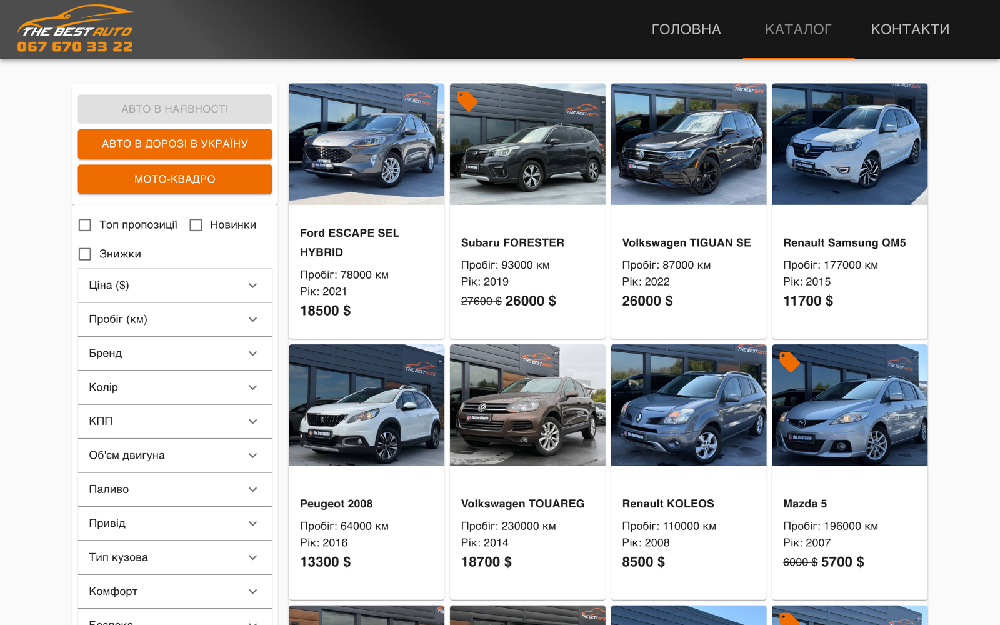
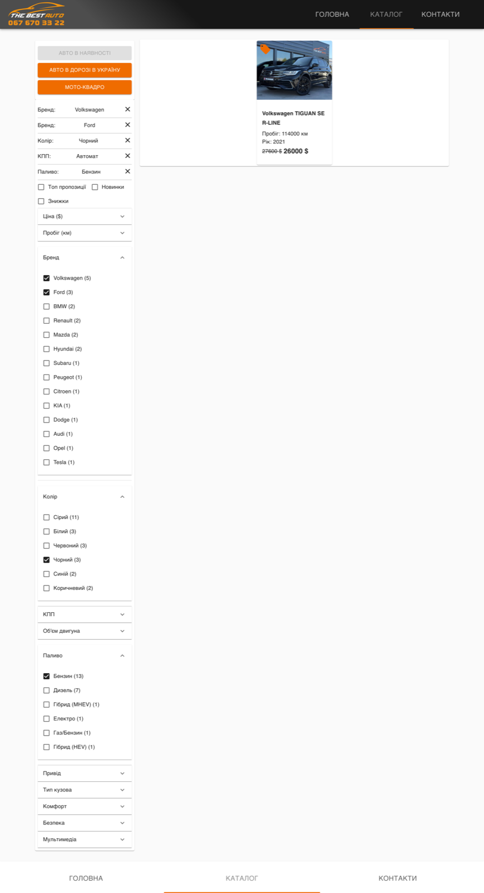
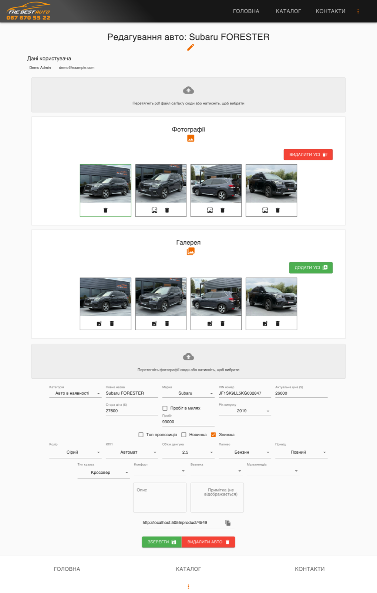
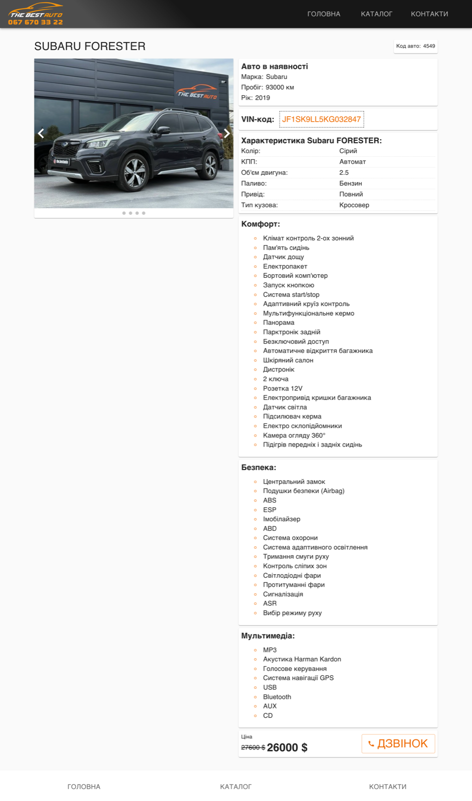

# The Best Auto: storefront + CRM

Used-car importer's catalog and back office in one React / TypeScript SPA.

| Catalog with facets | Five active facets, all in the URL |
|---|---|
|  |  |

| CRM: edit a listing | Product page |
|---|---|
|  |  |

More screens: [brand + price slider](docs/screenshots/catalog-filters-brand-price.png) ·
[attribute facets](docs/screenshots/catalog-filters-features.png) ·
[form validation](docs/screenshots/crm-add-validation.png) · [attribute select](docs/screenshots/crm-edit-attribute-select.png) ·
[mobile product](docs/screenshots/mobile-product.png) ·
[admin view of the catalog](docs/screenshots/catalog-admin.png) ·
[add listing](docs/screenshots/crm-add.png) · [mobile catalog](docs/screenshots/mobile-catalog.png) ·
[mobile filter drawer](docs/screenshots/mobile-filters-drawer.png) ·
[contacts map](docs/screenshots/contacts-map.png) · [home](docs/screenshots/home.png) ·
[empty state](docs/screenshots/catalog-empty-state.png) · [sign in](docs/screenshots/signin.png)

## Architecture

- Layers `pages → features → shared`, imports go one way: [Feature-Sliced Design](https://feature-sliced.design/docs/get-started/overview)
- Component levels atoms / molecules / organisms / templates / pages: [Atomic Design](https://atomicdesign.bradfrost.com/chapter-2/)
- State: one Redux Toolkit slice and a set of reselect selectors per feature
- Filter state is mirrored to the URL, so every filtered view is a link
- Material-UI theme as the design system

```
src/
  pages/        routes
  features/     catalog/ (filter/, categories/), product/, crm/, auth/, contacts/, ...
    <feature>/  slice.ts, selectors.ts, molecules/, organisms/, templates/
  shared/       atoms/, molecules/, organisms/, lib/, types/, config
  mocks/        in-browser API for local runs
```

## Run it

```bash
npm install --legacy-peer-deps
npm start
```

Runs on a mock API when `REACT_APP_API_URL` is not set. Demo login: any email and password on
`/auth/signin` opens the CRM.
